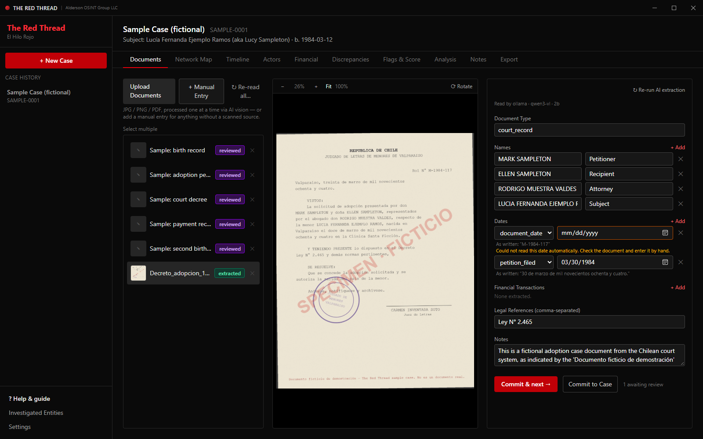
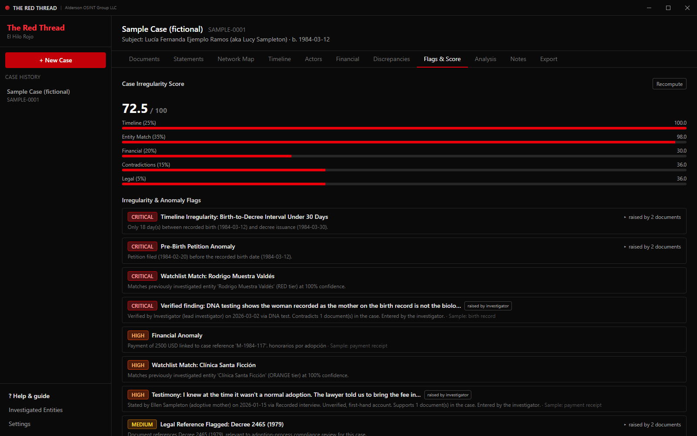
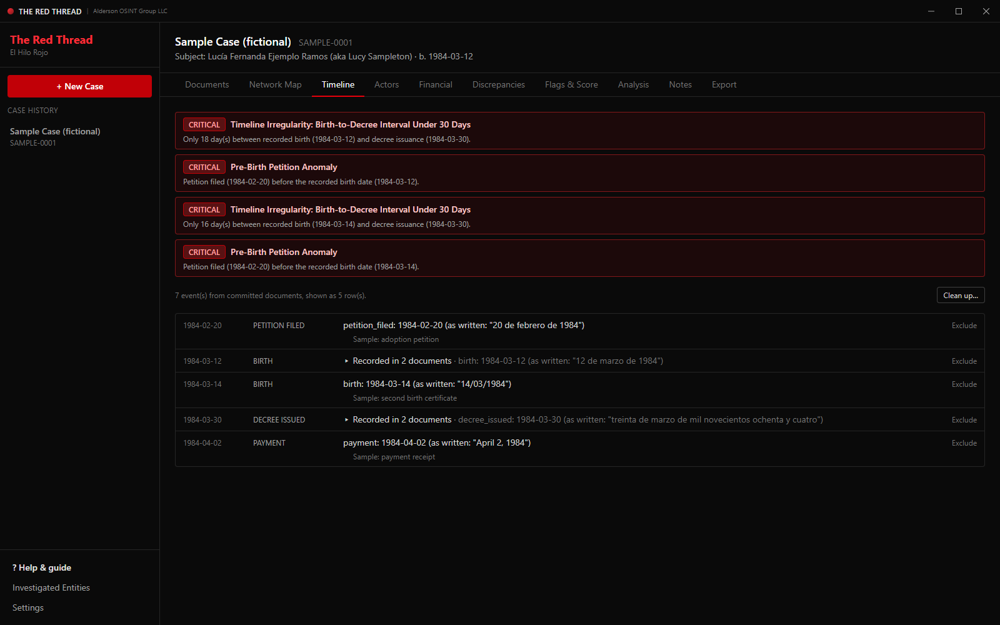
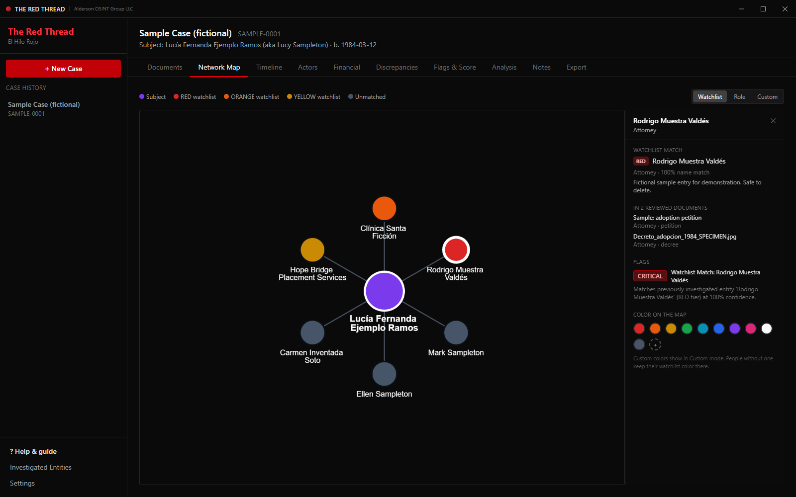
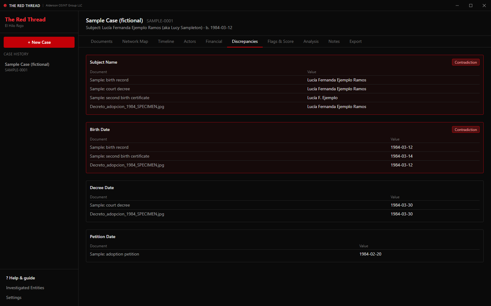
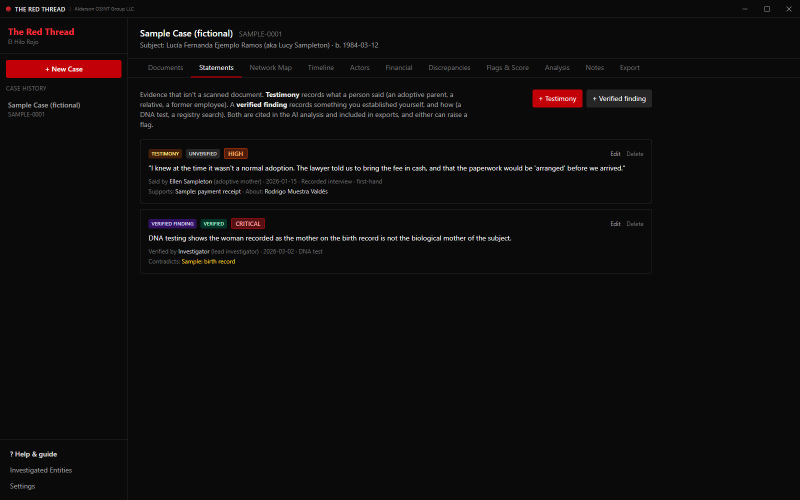
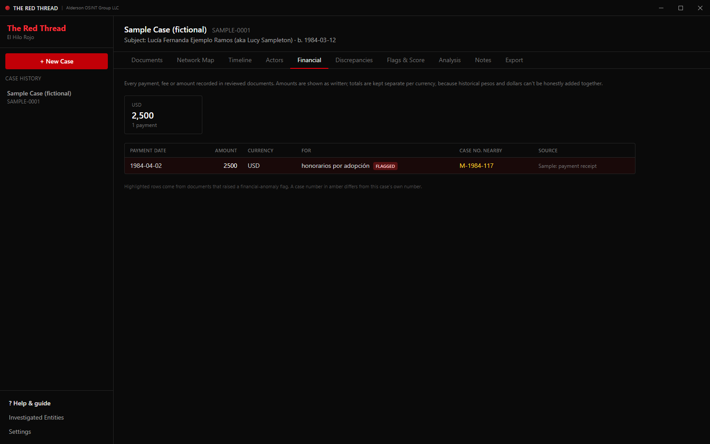
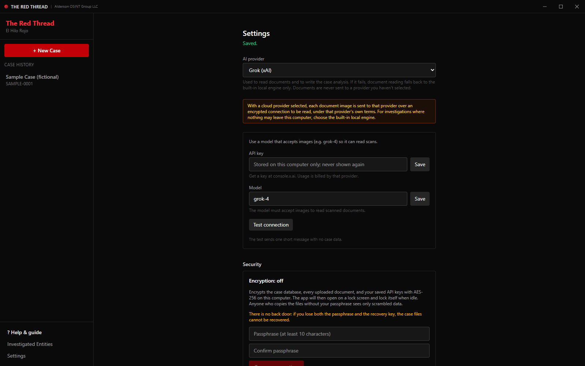

# The Red Thread · El Hilo Rojo

**Case analysis for investigations into irregular adoptions.**
Turn a box of scanned adoption records into a structured, reviewable case: who was involved, what happened when, where the money went, where the records contradict each other, and which patterns are irregular.

*Herramienta de análisis de casos para investigaciones de adopciones irregulares. La aplicación y su manual están disponibles en inglés y español.*


<sub>All names, documents and case numbers in these screenshots are fictional. The decree above is a specimen made for this README.</sub>

---

## Why this exists

Between the 1970s and the 1990s, thousands of children were adopted out of Chile to families abroad, many of them through processes that were irregular or worse: petitions filed before a baby was born, decrees issued days after birth, mothers told their child had died, fees "por adopción" changing hands. Chilean authorities have since opened investigations, and adoptees and birth families on both continents are still searching for each other.

The evidence for what happened is usually a paper trail: birth certificates, court petitions and decrees, notarial powers, agency letters and receipts. It is scattered across two countries and two languages, partly handwritten, often photocopied many times, and full of dates written out in words ("a los veinticuatro días del mes de agosto de mil novecientos ochenta y tres"). The signals that matter almost never sit in one document. They show up only when you line the documents up: a petition dated before a birth, a decree issued 18 days after it, the same attorney or clinic appearing across many families, a receipt referencing another case number.

Doing that by hand across dozens or hundreds of pages is slow, and it is easy to miss things. The Red Thread does the reading and cross-checking so that investigators, adoptees, families, journalists and lawyers can focus on the questions that matter.

The name comes from the East Asian legend of the red thread of fate: an invisible cord that connects people who are meant to find each other, which may stretch or tangle but never breaks.

## Who we are

The Red Thread is built by **Alderson OSINT Group LLC**. We have spent more than twenty years in cybersecurity and open-source intelligence: following paper trails, connecting people to records, and finding what was meant to stay hidden. Development was assisted by Eve, our in-house assistant.

This tool is personal to us. It began with the case of someone close to us, and with the experience of sitting in front of a pile of photocopied decrees, receipts and certificates, knowing the answers were somewhere in those pages. Every one of those pages stands for a family that was separated, and many of them were never told the truth.

We believe the truth belongs to the people it was taken from, and that justice must reach every victim: the adoptees, the mothers and fathers, the siblings, and the families still searching. The Red Thread is our contribution to that work. It puts the methods we use professionally into the hands of the people who need them most.

**This is only the beginning.** The Red Thread is under active development, and many updates are coming: more document types, more countries and legal frameworks, deeper analysis, and features shaped by the investigators, adoptees and families who use it. If you have ideas, find a bug, or want to help, please [open an issue](../../issues).

## What it does

| | |
|---|---|
| **Reads the documents** | Upload photos or PDFs. An AI vision model reads every page (Spanish or English, typed, handwritten or stamped) and extracts names and roles, dates, payments, case numbers and legal references. |
| **You decide** | Nothing the AI reads counts until a person has checked it against the original, shown side by side, and clicked **Commit**. Every reading records which AI produced it. |
| **Testimony & findings** | Record what people told you (an adoptive parent, a relative, a former employee) and what you verified yourself (a DNA test, a registry search), with who, when, how, and how reliable. Link entries to the documents they support or contradict; they are cited in the analysis and can raise flags. |
| **Timeline** | Every dated event in order, with the date exactly as written next to its interpretation. Spanish notarial dates written in words are understood. |
| **Flags & score** | Automatic red flags: pre-birth petitions, birth-to-decree intervals under 30 days, irregular payments, contradictions between documents, citations of adoption-era decrees, and matches against a watchlist of previously investigated people and institutions. |
| **Discrepancies** | Every place the documents disagree: two different birth dates, name variants, conflicting case numbers. |
| **Financial** | Every payment and fee, with totals kept per currency (historical pesos and dollars are never added together). |
| **Network map** | Everyone named in the case and how they connect. Click a person for every document that mentions them and the flags that concern them. |
| **AI analysis** | A written summary and hypotheses about what may have happened, each with evidence for and against it. Every citation is checked against the case record, and anything unsupported is marked as such. |
| **Export** | A complete PDF case report, or the full case as JSON. |

<table>
<tr>
<td width="50%"><br><sub><b>Flags & Score:</b> an 18-day birth-to-decree interval, a petition filed before the birth, and a watchlist match, each traced to its source documents.</sub></td>
<td width="50%"><br><sub><b>Timeline:</b> every date shown as interpreted and as written; events recorded in several documents are grouped.</sub></td>
</tr>
<tr>
<td><br><sub><b>Network map:</b> click a person to see where they appear and why they are flagged.</sub></td>
<td><br><sub><b>Discrepancies:</b> two birth certificates that disagree by two days.</sub></td>
</tr>
<tr>
<td colspan="2"><br><sub><b>Statements:</b> an adoptive parent's testimony that supports a payment record, and a DNA finding that contradicts the birth record, each raising a flag marked as investigator-raised.</sub></td>
</tr>
<tr>
<td><br><sub><b>Financial:</b> a payment "por adopción" that references a different case number.</sub></td>
<td><br><sub><b>Settings:</b> use Claude, Grok, OpenAI, Gemini, any OpenAI-compatible service, or the built-in local engine.</sub></td>
</tr>
</table>

## Principles

- **The AI reads, a person decides.** AI output is a draft. Only documents a reviewer has checked and committed feed the timeline, flags, score and analysis.
- **Nothing is invented.** Dates are kept exactly as written next to their interpretation. Partial or ambiguous dates are marked for a person to resolve, never guessed. AI analysis cites its sources, and those citations are verified in code.
- **Your case stays on your computer.** There is no account and no server. Case files can be encrypted with a passphrase (AES-256, SQLCipher). Documents go to a cloud AI only if you choose one, and you can work entirely offline with the built-in engine.
- **Careful language.** Flags describe irregularities in the record. They are not accusations, and the analysis is written to keep facts, inferences and benign explanations separate.

## AI providers

| Provider | Notes |
|---|---|
| **Claude** (Anthropic) | Recommended. Best accuracy on dense, handwritten and Spanish legal documents. |
| **Grok** (xAI), **OpenAI**, **Gemini** (Google) | Bring your own API key; choose a model that accepts images. |
| **Any OpenAI-compatible service** | OpenRouter, Mistral, DeepSeek, Groq, Together, or a model running on your own machine (LM Studio, vLLM). |
| **Built-in local engine** | Qwen3-VL 2B via Ollama, included in the installer. Free, offline, nothing leaves the computer. Slower and less complete; it cannot run the case analysis. |

If the chosen cloud provider fails, reading falls back only to the local engine. Documents are never sent to a provider you didn't select.

## Install (Windows)

1. Download `The Red Thread_x.y.z_x64-setup.exe` from [Releases](../../releases).
2. Run it. If Windows shows "Windows protected your PC", click **More info → Run anyway** (the installer is not yet code-signed).
3. The app opens on a **Help & guide** page with a step-by-step quick start in English and Spanish. Click **Open the practice case** to explore a fully fictional case first.

Requirements: Windows 10 or 11 (64-bit), about 3 GB of disk space, and 8 GB of RAM or more for the local engine. Internet is only needed during installation and when using a cloud AI.

The full user manual is built into the app (**Help & guide → Full manual**) and available as PDF: [English](docs/Red_Thread_User_Manual_EN.pdf) · [Español](docs/Red_Thread_Manual_de_Usuario_ES.pdf).

## Important

The Red Thread is an investigative aid. Its readings, flags, scores and AI-written analyses can be incomplete or wrong. They are not evidence, not legal advice, and not a finding that any person did anything wrong. Verify everything against the original documents and seek qualified legal advice before relying on it. References to Chilean law are general information and should be checked by counsel.

If you are an adoptee or birth relative, please also look after yourself. This work can be painful. Consider involving people you trust, and organizations experienced in searches and reunions.

## Build from source

Requirements: Python 3.11, Node.js 20+, Rust (stable), and on Windows the MSVC build tools.

```powershell
# Backend
cd backend
python -m venv venv
venv\Scripts\pip install -r requirements.txt pyinstaller
venv\Scripts\python -m pytest -q          # run the test suite

# Frontend
cd ..\frontend
npm install

# Local AI engine (not stored in git: large binaries)
#  - copy ollama.exe (0.32.x) to frontend\src-tauri\binaries\ollama-x86_64-pc-windows-msvc.exe
#    and its lib\ollama folder to frontend\src-tauri\resources\lib\ollama
#  - `ollama pull qwen3-vl:2b`, then copy the model's manifest and blobs into
#    frontend\src-tauri\resources\ollama_models (paths listed in tauri.conf.json)

# Installer
pwsh ..\scripts\build-release.ps1
```

`scripts/build-release.ps1` runs the tests, freezes the backend, builds the app, checks the build for any names listed in a private, git-ignored `scripts/private-names.txt`, and produces a signed installer when a code-signing certificate is configured.

Stack: Tauri 2 (Rust) desktop shell · React + TypeScript + Vite · FastAPI (Python) backend packaged with PyInstaller · SQLite / SQLCipher · Ollama for local inference.

## License

© 2026 Alderson OSINT Group LLC. All rights reserved. Use of the installer is governed by the [license agreement](legal/EULA.txt). Third-party components keep their own licenses: see [THIRD_PARTY_NOTICES](legal/THIRD_PARTY_NOTICES.txt).
